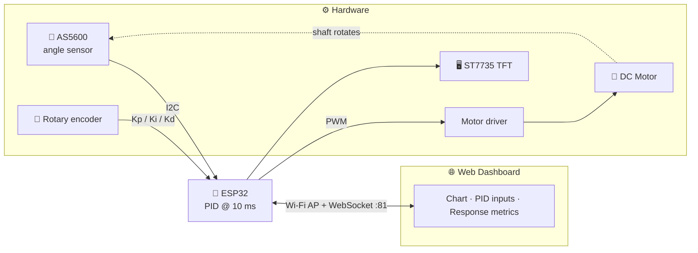
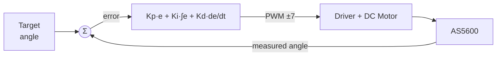

# 🎛️ PID Trainer


> A learning module for **PID angular position control of a DC motor**, built on the ESP32. Tune Kp, Ki, and Kd with a **rotary encoder** or from a **web dashboard** over Wi-Fi, and watch the system response as a **real-time chart**.

Developed for the **Electronic Engineering Department, Vocational Faculty**, as a teaching aid for control systems labs.

---

## 📑 Table of Contents

1. [Overview](#-overview)
2. [Features](#-features)
3. [System Architecture](#-system-architecture)
4. [Hardware](#-hardware)
5. [Required Libraries](#-required-libraries)
6. [Getting Started](#-getting-started)
7. [Usage](#-usage)
8. [PID Configuration](#-pid-configuration)
9. [WebSocket Protocol](#-websocket-protocol)
10. [Repository Structure](#-repository-structure)
11. [Notes & Known Limitations](#-notes--known-limitations)
12. [References](#-references)
13. [License](#-license)

---

## 🔎 Overview

PID Trainer is an angular position control trainer. An **AS5600** magnetic sensor reads the angle of the DC motor shaft, the ESP32 computes the PID control signal every **10 ms**, and the motor driver moves the shaft toward the target angle.

Users can change the PID parameters and immediately see the effect on the motor response: *rise time*, *settling time*, *overshoot*, and *steady-state error*.

---

## ✨ Features

| Category | Feature |
|---|---|
| 🎚️ **Control** | Angular position PID with a 0.5° deadband and ±30° angle limits |
| 🔘 **Physical interface** | Kp/Ki/Kd tuning with a rotary encoder, values shown on a 1.44" TFT |
| 🌐 **Web dashboard** | Real-time chart, PID inputs, *Record*, *Pause*, and *Screenshot* buttons |
| 📊 **Response analysis** | Rise time, settling time, overshoot, and steady-state error |
| 📡 **Connectivity** | ESP32 as an *Access Point* with a *captive portal* |
| 🧲 **Sensor** | AS5600 magnet position check at boot |
| 🔄 **Reset** | Reset PID parameters by holding the encoder button or from the web |

---

## 🏗️ System Architecture



### PID Control Loop



---

## 🔌 Hardware

### Main Components

| Component | Notes |
|---|---|
| Microcontroller | ESP32 DevKit (WROOM-32) |
| Angle sensor | AS5600 12-bit magnetic encoder |
| Motor driver | L298N (per the component list) |
| Step-down converter | LM2596 |
| Display | 1.44" 128×128 ST7735 TFT |
| Input | Rotary encoder with push button |
| Power | 12V 2A DC adapter + panel-mount DC jack |

The full component list with purchase links is in [`Project/Hardware/KOMPONEN FIKS.md`](Project/Hardware/KOMPONEN%20FIKS.md).

### ESP32 Pin Mapping

| Device | Signal | GPIO |
|---|---|---|
| **AS5600** (I2C, address `0x36`) | SDA | 16 |
| | SCL | 17 |
| **ST7735 TFT** | CS | 5 |
| | RST | 4 |
| | DC | 15 |
| **Rotary encoder** | CLK | 32 |
| | DT | 25 |
| | SW | 13 |
| **Motor driver** | RPWM | 26 |
| | LPWM | 27 |
| | REN | 22 |
| | LEN | 21 |

> ⚠️ The remaining TFT signals (SCK/MOSI) use the ESP32's default SPI pins.

---

## 📦 Required Libraries

Install via the Arduino Library Manager (or PlatformIO):

| Library | Purpose |
|---|---|
| `Adafruit GFX` | Basic graphics for the TFT |
| `Adafruit ST7735 and ST7789` | ST7735 display driver |
| `ESPAsyncWebServer` (+ `AsyncTCP`) | Asynchronous web server |
| `WebSocketsServer` (arduinoWebSockets) | Real-time communication |
| `ArduinoJson` | JSON messages |
| `Wire`, `WiFi`, `DNSServer`, `SPIFFS` | Included with the ESP32 Arduino core |

---

## 🚀 Getting Started

1. **Assemble the hardware** following the [pin mapping](#esp32-pin-mapping) above.
2. **Open the firmware** in the Arduino IDE: `Project/Firmware/main/main.ino`.
3. **Select the board** ESP32 Dev Module and install all [required libraries](#-required-libraries).
4. **Upload the web files to SPIFFS.** The `data/` folder (containing `index.html`, `chart.min.js`, `tailwind.js`) must be uploaded with the *ESP32 Sketch Data Upload* plugin.
5. **Upload the sketch** to the ESP32.
6. On boot, the display shows `Checking Magnet...` until the magnet is detected at the right distance. Adjust the magnet-to-AS5600 gap until the status clears.

---

## 🕹️ Usage

### Via the Web Dashboard

1. Connect your device to the Wi-Fi network:

   | | |
   |---|---|
   | **SSID** | `PID Trainer` |
   | **Password** | `motordc1` |

2. Open **`http://192.168.4.1`** (it should open automatically through the *captive portal*), then go to the *Web Interface*.
3. The dashboard starts in **View** mode (read-only). Flip the toggle to **Edit** mode to change parameters.
4. Enter Kp, Ki, and Kd values, then press **Set Parameter**.
5. Use **Record** to capture data, **Pause** to freeze the chart, and **Screenshot** to save an image of the chart.

### Via the Rotary Encoder

| Action | Result |
|---|---|
| **Rotate** | Increase/decrease the active parameter (highlighted in yellow on the TFT) |
| **Short press** | Switch parameter: Kp → Ki → Kd → Kp |
| **Hold 1.5 s** | Reset Kp, Ki, Kd to 0 (with a progress bar on screen) |

| Parameter | Step per click | Range |
|---|---|---|
| Kp | 0.1 | 0 – 1.0 |
| Ki | 0.0001 | ≥ 0 |
| Kd | 0.001 | ≥ 0 |

---

## 🎚️ PID Configuration

Initial values and key parameters in `main.ino`:

| Parameter | Value | Description |
|---|---|---|
| `Kp` | 0.4 | Initial proportional gain |
| `Ki` | 0.0003 | Initial integral gain |
| `Kd` | 0.001 | Initial derivative gain |
| `pidInterval` | 10 ms | PID computation period |
| Deadband | 0.5° | Errors below this value are treated as zero |
| PWM output | −7 … +7 | PID output is clamped (`constrain`) before reaching the driver |
| `CW_LIMIT` / `CCW_LIMIT` | +30° / −30° | The motor stops when the angle limit is exceeded |
| `offsetFromZpos` | 145 | Offset of the mechanical zero relative to the AS5600 reading |

The angle is read from AS5600 register `0x0E`, converted with `raw × 0.087890625` (360 / 4096), reduced by `offsetFromZpos`, then normalized to the −180° … +180° range.

---

## 📡 WebSocket Protocol

The WebSocket server runs on **port 81** (`ws://192.168.4.1:81/`).

**ESP32 → Web** (sent every PID cycle):

```json
{
  "motor": 12.3,
  "kp": 0.4,
  "ki": 0.0003,
  "kd": 0.001,
  "error": -2.1,
  "pid_out": 3.0,
  "time_s": 42.5
}
```

> The `kp`, `ki`, `kd` fields are not sent while **Edit** mode is active, so the input fields are not overwritten.

**Web → ESP32:**

| Command | Example message |
|---|---|
| Change mode | `{"type":"mode","value":"edit"}` or `"view"` |
| Update a parameter | `{"type":"pid_single","parameter":"kp","value":0.5}` |
| Reset parameters | `{"type":"calibrate"}` |

---

## 📁 Repository Structure

```text
PID-Trainer/
├── LICENSE
├── README.md
└── Project/
    ├── Firmware/
    │   ├── main/                  # ⭐ Main firmware
    │   │   ├── main.ino
    │   │   ├── KalmanFilter.h/.cpp
    │   │   ├── WebSocketServer.h
    │   │   └── data/              # Web files for SPIFFS (index.html, chart.min.js, tailwind.js)
    │   └── dev-process/           # Experimental & test sketches from development
    │       ├── as5600-overall/    #   AS5600 reading tests
    │       ├── auto-cal-as5600/   #   automatic zero calibration
    │       ├── motor-*/           #   motor tests
    │       ├── pid-*/             #   PID & dashboard iterations
    │       └── GUI/               #   GUI prototypes (Python & HTML)
    ├── Hardware/                  # Component list
    ├── Notes/                     # Project notes
    └── Refferences/               # Concept, hardware, and image references
```

---

## 📝 Notes & Known Limitations

- 🧪 The `dev-process/` folder holds experimental sketches and is **not** part of the final firmware.
- 🎯 The dashboard's **Set Target** button sends a `target_set` message, but `main.ino` currently has no handler for it, so `targetAngle` stays fixed at 0°.
- 🧮 `KalmanFilter` is included and initialized, but is not yet used for angle readings in the main loop.
- 🔒 The Wi-Fi password is hard-coded. Change it if the device is used in a public environment.
- ⏱️ `driveMotor()` contains a `delay(10)`, which blocks the main loop on every control cycle.

---

## 📚 References

Concept references for PID, motor hardware options, and UI comparison images are in [`Project/Refferences`](Project/Refferences/README.md).

---

## 📄 License

Released under the **[MIT License](LICENSE)**. © 2025 Teknik Elektronika UNY.
